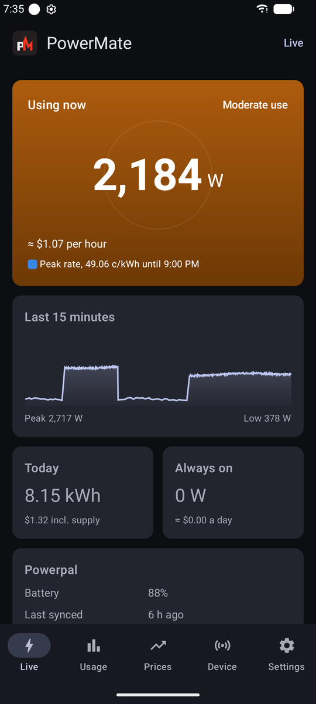
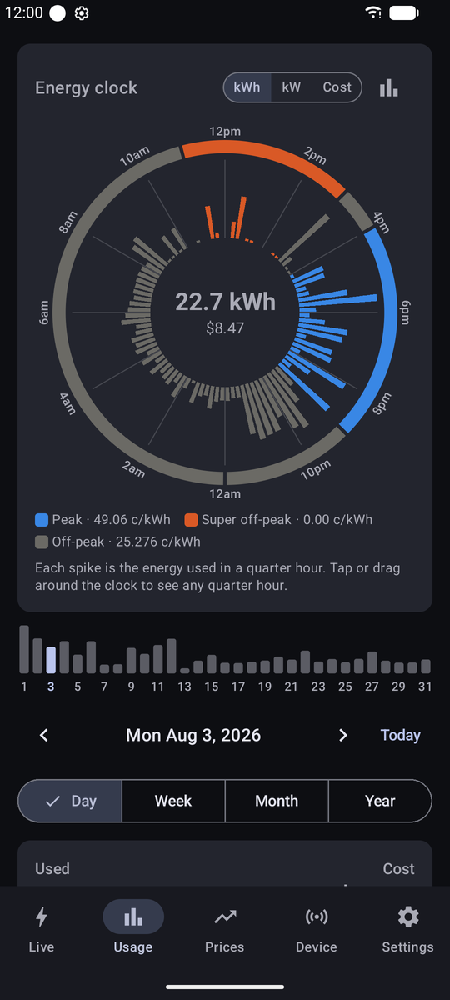
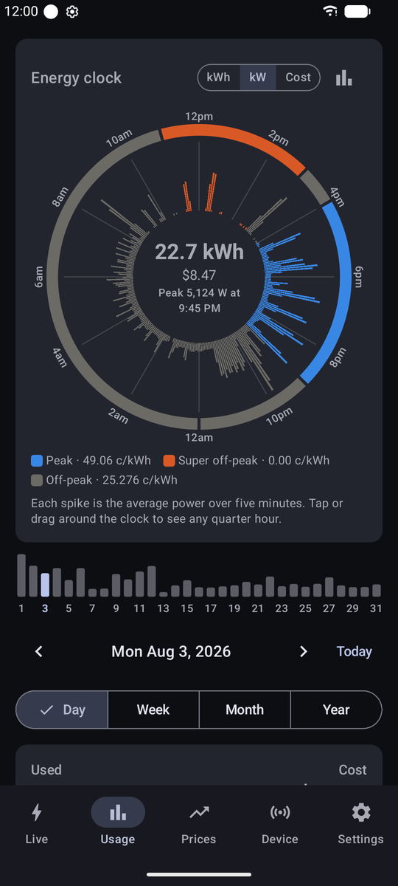
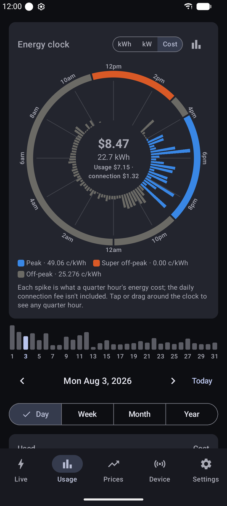
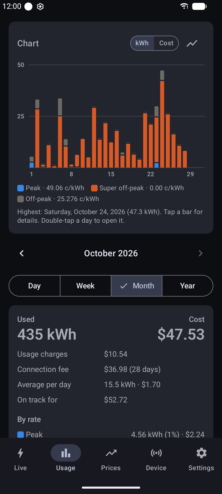
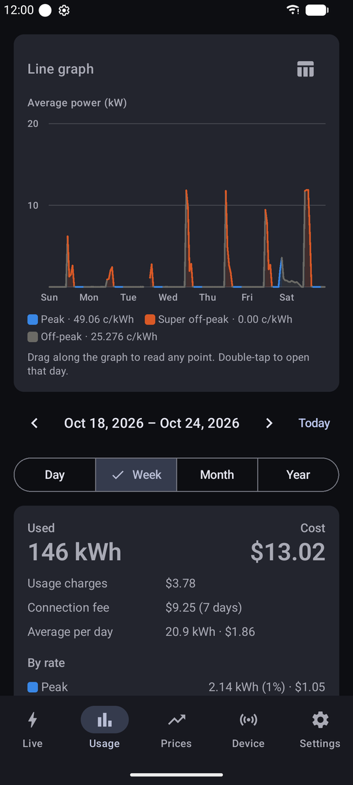
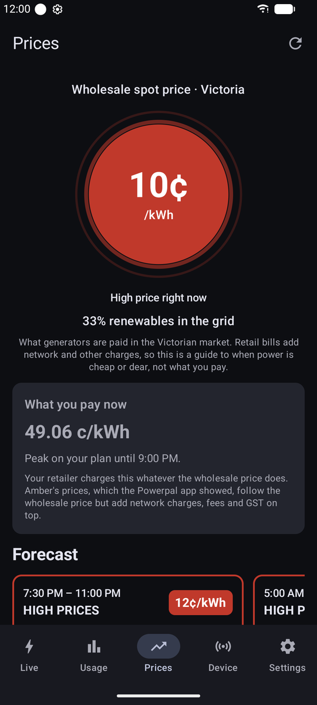
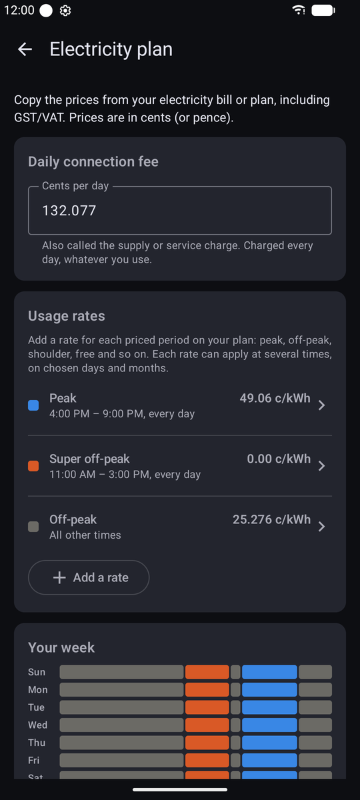
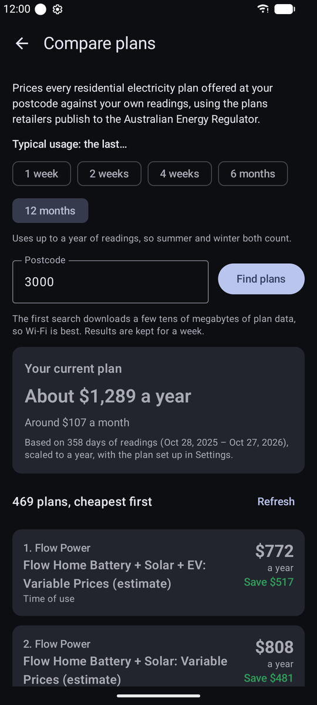

# PowerMate

A free, independent Android app for **Powerpal** Bluetooth energy monitors. The official Powerpal
app is no longer maintained; PowerMate keeps the hardware useful by talking to the Powerpal
directly over Bluetooth and keeping your readings on your phone. There's no account to create
and no PowerMate server.

**Now in beta on Google Play.** [Join the beta](#join-the-beta) to get the app free today and
help bring it to every Powerpal owner. Homepage:
[aksevenfour.com/powermate](https://aksevenfour.com/powermate)

> PowerMate is not made by, endorsed by or affiliated with Powerpal. "Powerpal" is used only to
> say which device the app works with.

## Screenshots

<table>
  <tr>
    <td align="center" width="33%"><br><sub>Live power and the last 15 minutes</sub></td>
    <td align="center" width="33%"><br><sub>Energy clock: energy per quarter hour, coloured by rate</sub></td>
    <td align="center" width="33%"><br><sub>Energy clock: five-minute power, with the day's peak</sub></td>
  </tr>
  <tr>
    <td align="center" width="33%"><br><sub>Energy clock: what each quarter hour cost</sub></td>
    <td align="center" width="33%"><br><sub>A month of daily use, split by rate</sub></td>
    <td align="center" width="33%"><br><sub>A week's power as a line graph</sub></td>
  </tr>
  <tr>
    <td align="center" width="33%"><br><sub>Wholesale prices, renewables share and forecast</sub></td>
    <td align="center" width="33%"><br><sub>Time-of-use plan editor</sub></td>
    <td align="center" width="33%"><br><sub>Every plan at a postcode, priced against your usage</sub></td>
  </tr>
</table>

## Features

**Live and history**

- Live power from the Powerpal's meter pulses, averaged over 15 seconds, with what it's costing
  per hour at your current rate and a 15-minute trend. A minute without a pulse reads 0 W, for
  when solar or a battery is covering the house.
- Catches up on new readings whenever it connects, and in the background every couple of hours.
  Older history still in the Powerpal's memory (about 60 days) can be downloaded on request.
- Optional import of your history from Powerpal's cloud, minute by minute, for as long as
  Powerpal's servers stay online.
- CSV export of every reading.

**Usage**

- Day, week, month and year views as a bar chart, line graph or table, in kWh or dollars.
- An energy clock for each day: a 24-hour dial of quarter-hour energy (kWh), five-minute power
  (kW) or cost, coloured by the rate in force, with a strip of the month's days for quick
  navigation.
- Double-tap a month or day in any chart to open it.
- Always-on (baseline) load estimate.

**Costs and plans**

- Flat-rate or time-of-use tariffs (peak, shoulder, off-peak, free periods; weekday and weekend;
  seasonal) and a daily connection fee, plus a projection for the current week, month or year.
- Plan comparison (Victoria): prices your own readings against every residential electricity
  plan offered at your postcode, using the plan data retailers publish under the Consumer Data
  Right. Choose how much recent usage counts as typical, from one week to twelve months, and
  adopt any plan as your PowerMate tariff in one tap.

**Prices (Victoria)**

- The wholesale spot price for Victoria from AEMO, or your own all-in price if you're an Amber
  Electric customer with an API token.
- The grid's renewables share, a 24-hour forecast that picks out cheap and expensive stretches,
  and a chart of today's half-hourly prices.

**Notifications**

- Reminders before cheap and expensive rate periods start, high usage, heavy use at your dearest
  rate, a rising always-on load, daily and weekly summaries, a low Powerpal battery, and
  wholesale price spikes.
- An optional "stay connected" mode keeps a live connection in the background so usage alerts
  work with the app closed.

**Device**

- Battery level, firmware, how much history the Powerpal holds, and its pairing code, so it
  isn't lost.
- A Bluetooth diagnostics log you can share when reporting a problem.

Price and plan features currently cover Victoria only. Everything else works anywhere.

## Requirements

- An Android phone running Android 8.0 or newer, with Bluetooth LE.
- A Powerpal monitor and its 6-digit pairing code (on the card that came with it, in the
  original app, or recovered in-app if the device is registered with Powerpal).
- Your meter's rate in impulses per kWh, printed on the meter (usually 1000).

## Join the beta

PowerMate is in closed testing on Google Play. Before Google will list it for everyone, at least
12 testers need to stay in the test for 14 days in a row.

1. Sign in with the Google account you use on your Android phone, then join the
   [powermate-testers](https://groups.google.com/g/powermate-testers) group.
2. With the same account, open the
   [PowerMate testing page](https://play.google.com/apps/testing/com.aksevenfour.powermate) and
   tap **Become a tester**.
3. Install [PowerMate from Google Play](https://play.google.com/store/apps/details?id=com.aksevenfour.powermate).
   If it says the item isn't found, give it an hour and try again.

Please stay in the test for the full 14 days and don't tap **Leave the program**. You don't need
a Powerpal to count as a tester. Problems or ideas? [Open an issue](https://github.com/AdamKeher/powermate/issues).

## Getting started

1. Close or uninstall the original Powerpal app. A Powerpal talks to only one app at a time.
2. Install PowerMate: [join the beta](#join-the-beta), or [build it yourself](#building).
3. Open PowerMate, tap **Find my Powerpal**, pick your device and enter its pairing code. Lost the
   code? If the Powerpal is registered with Powerpal, tap **I can't find my pairing code** to have
   it sent to the owner's registered email and mobile.
4. Enter your electricity plan under **Settings → Electricity plan → Edit plan**, or find it
   with **Compare plans for my usage** and tap **Use as my plan in PowerMate**.
5. Optionally, import your older history under **Settings → Import history from Powerpal's
   cloud**. PowerMate fills in the device ID and key from your Powerpal when it can.

## Privacy

Your readings are stored only on your phone, and nothing is sent to the developer. PowerMate
connects to these services, only for the features that need them:

| Service | Used for | What's sent |
|---|---|---|
| AEMO (`visualisations.aemo.com.au`) | Wholesale prices, price alerts | Nothing personal |
| Amber Electric (`api.amber.com.au`) | Renewables share; your prices if you add a token | Your token, only if you add one |
| AER Energy Made Easy (`cdr.energymadeeasy.gov.au`) | Plan comparison | Nothing personal: plans are filtered by postcode on the phone |
| Powerpal (`readings.powerpal.net`) | History import, only when you run it | Your Powerpal's device ID and key |
| Powerpal (`devices.powerpal.net`) | Recovering a lost pairing code, only when you tap it | The device's serial; the code is sent to the owner's registered email and mobile, never to the app |

Permissions: Bluetooth (to find and connect to the Powerpal; on Android 11 and older, Android
also requires location access to scan), notifications, and a connected-device foreground
service for the optional background connection.

## Building

You'll need the Android SDK (platform 36) and JDK 17–21. Android Studio's bundled JDK works.

```sh
./gradlew :app:testDebugUnitTest :app:assembleDebug
./gradlew :app:installDebug   # with a phone connected over adb
```

Or open the project in Android Studio and press Run. If Gradle can't find a JDK, point
`JAVA_HOME` at Android Studio's (for example `"/c/Program Files/Android/Android Studio/jbr"`
on Windows).

Library versions are pinned (AGP 8.13, Kotlin 2.2, Compose BOM 2025.10) to a set that builds
against compileSdk 36; newer AndroidX releases need compileSdk 37 and AGP 9, so lint's "newer
version available" warnings are expected. Release builds are minified; sign them with your own
key.

## Project layout

Source lives under `app/src/main/java/com/aksevenfour/powermate/`.

| Path | What |
|---|---|
| `ble/` | Bluetooth: UUIDs, payload encoding (`PowerpalProtocol`, unit tested), a coroutine GATT wrapper, and the session logic in `PowerpalManager` |
| `data/` | Room database of readings, DataStore settings, the tariff model, usage aggregation, CSV export and cloud import |
| `prices/` | Wholesale and Amber prices, and the cheap/expensive window analysis |
| `plans/` | Consumer Data Right plan download, parsing and pricing |
| `notify/` | Notifications, reminders, background workers and the live-connection service |
| `sync/` | Periodic background sync |
| `ui/` | Jetpack Compose screens and components |

## Bluetooth protocol

PowerMate builds on the protocol work in
[pento/powerpal-esphome](https://github.com/pento/powerpal-esphome) (MIT), itself based on
WeekendWarrior1's research. The Powerpal exposes service `59DAABCD-12F4-25A6-7D4F-55961DCE4205`;
its characteristics are `59DAxxxx-12F4-25A6-7D4F-55961DCE4205`. All integers are little-endian.

| Char | Op | Payload |
|---|---|---|
| `0011` pairing code | write | 6-digit code as u32. Required before anything else works |
| `0004` time | write | Unix seconds, u32. Lost on battery change; set every session |
| `0013` reading batch size | read/write | Minutes per record, u32 |
| `0005` first_rec | read | `[first_ts, last_ts]`, 2×u32: the range of stored records |
| `0002` measurement access | write | `[start_ts, end_ts]`, 2×u32: stream that range over `0001` |
| `0001` measurement | notify | `ts u32` + `pulses u16` per record |
| `0003` pulse | notify | u32 ms between pulses; W = 3.6e9 / (imp/kWh × ms) |
| `0008` LED sensitivity | read | Format unknown (shown raw) |
| `0009` API key | read | 16 bytes, formatted as a UUID, for Powerpal's cloud API |
| `180F/2A19` | read | Battery % |
| `180A/*` | read | Device information strings |

A session: connect → discover services → write the pairing code → write the time → set the
batch size to 1 minute → read device information → subscribe to `0001` → read `0005` → request
missing records through `0002` → subscribe to `0003` for live power.

`0003` doesn't notify on every pulse under heavy load. At 12 kW on a 1000 imp/kWh meter, every
report said 300 ms but reports arrived only every 0.4–2.7 s, so a late report doesn't mean the
load has dropped.

## Pairing code recovery

A Powerpal that's been registered with Powerpal (via the original app's "About your home") can
have its pairing code resent, so a lost code doesn't mean a factory reset. This mirrors the
original app's "I can't find my pairing code" link.

| Request | Response |
|---|---|
| `POST https://devices.powerpal.net/api/v1/energy_bridges/<serial>/pairing_code_recovery` | `200` the code was sent to the owner's registered email and mobile · `404` the device isn't registered · other: failed |

The `<serial>` is the 8-character hex device ID, the suffix of the Bluetooth name (`Powerpal
0004fe98` → `0004fe98`). The request takes no body and no authentication, but the server requires
a `Content-Length` header (send `0`). The code is only ever sent to the contact details the owner
registered, never returned in the response, so the serial alone can't be used to read someone
else's code — it can only prompt Powerpal to resend it to that owner. These details come from the
official app (`net.powerpal.PowerPal`); they aren't part of Powerpal's documented API, so they may
change.

## Contributing

Bug reports and pull requests are welcome. For Bluetooth problems, include the log from
**Device → Bluetooth diagnostics**, along with your phone model, Android version and the
Powerpal's firmware version (shown on the Device tab).

## Disclaimer

PowerMate is provided as-is, without warranty. Costs, projections and plan comparisons are
estimates from your readings and the tariff details you enter or download; check with your
retailer before making decisions based on them.

## License

PowerMate is released under the [MIT License](LICENSE). The Bluetooth protocol details come
from [pento/powerpal-esphome](https://github.com/pento/powerpal-esphome), also MIT licensed.
